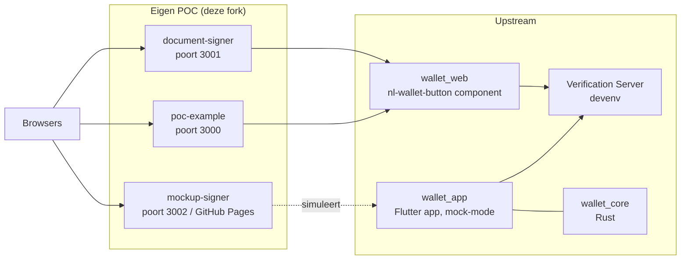

# Architectuur

Deze repository is een **fork van [MinBZK/nl-wallet](https://github.com/MinBZK/nl-wallet)**
met eigen Proof-of-Concept-uitbreidingen voor het digitaal ondertekenen van
documenten met de NL Wallet. Dit document beschrijft hoe de fork is ingericht,
welke componenten van upstream komen en welke eigen POC-componenten erbij zijn
gevoegd.

## Fork-model en sync-strategie

| Branch | Inhoud |
|---|---|
| `main` | Upstream (`MinBZK/nl-wallet`) + eigen, conflictvrije toevoegingen: `mockup-signer/`, `document-signer/`, `poc-example/`, POC-gidsen en deze architectuurdocumentatie |
| `poc/wallet-app-integratie` | Wijzigingen **in** upstream-code (wallet_app POC-integratie + lokale platformconfiguratie), gebaseerd op de upstream-versie van nov 2025 |

Sync-procedure voor toekomstige updates:

```bash
git fetch upstream
git merge upstream/main        # eigen mappen conflicteren niet met upstream
git push origin main
```

De wallet_app-wijzigingen op de poc-branch zijn bewust **niet** in `main`
gemerged: upstream heeft in een jaar tijd de disclosure-flow en de
wallet_core-API doorontwikkeld, waardoor die wijzigingen eerst geport moeten
worden (zie [Port-notities](#port-notities)).

## Upstream-componenten

| Map | Rol |
|---|---|
| `wallet_app/` | De NL Wallet-app (Flutter/Dart), met mock-implementaties via `--dart-define=MOCK_REPOSITORIES=true` |
| `wallet_core/` | Rust-core (MDOC-credentials, cryptografie, sessies) met Flutter-bindingen via `flutter_rust_bridge` |
| `wallet_web/` | Web component (`<nl-wallet-button>`, IIFE-build in `dist/`) waarmee een website een wallet-disclosure-sessie start |
| `wallet_admin_portal/` | Vue 3-webgui voor beheertaken (blokkeren/revoceren) via de administratieve API (nieuwe upstream-component, nov 2026) |
| `wallet_docs/` | Documentatie-site (Sphinx/Structurizr), incl. `architecture/` |
| `deploy/`, `scripts/`, `fastlane/` | Deployment, development-omgeving (`scripts/start-devenv.sh`), release-automatisering |
| `browsertests/`, `uiautomation/`, `testreporting/`, `demo/` | Test- en demo-infrastructuur |

## Eigen POC-componenten

### `document-signer/` — ondertekenen met echte disclosure-flow

Webapplicatie om PDF's te ondertekenen met NL Wallet-credentials.

- **Frontend** (`frontend/`): signing-pagina (`index.html`) en
  verificatiepagina (`verify.html`); gebruikt de `wallet_web`-library via een
  relatieve symlink naar `../../wallet_web`
- **Backend** (`backend/`, Express, poort **3001**): session-API die aansluit
  op de wallet_web polling-protocol, PDF-signing met RSA-SHA256 (`pdf-lib`),
  verificatie-endpoint en public-key endpoint
- **Flow**: browser → wallet_web button → backend sessie → (mock) wallet
  disclosure → credentials → RSA-handtekening + signature block in de PDF →
  deelbare verificatie-link/QR
- `certs/`: zelfgegeneerde testcertificaten (uitsluitend voor de PoC)

### `mockup-signer/` — visuele demo zonder backend-afhankelijkheden

Interactieve animatie/simulatie van het ondertekeningsproces.

- **Frontend** (`frontend/`): volledig statisch; `demo.html` is de
  stap-voor-stap animatie, `index.html`/`verify.html` de "echte" pagina's
- **Backend** (`backend/`, poort **3002**): alleen nodig voor de
  PDF-uploadmodus; de demo werkt zonder
- **Deployment**: `.github/workflows/deploy-mockup.yml` publiceert de frontend
  automatisch naar **GitHub Pages** bij wijzigingen op `main`
- Ondertekent met functienaam/afdeling en organisatie-ID in plaats van
  persoonsgegevens

### `poc-example/` — voorbeeldintegratie wallet_web

Minimale referentie-implementatie voor derden.

- Één Express-server (poort **3000**) serveert zowel de API als de statische
  frontend (`index.html`, `test_button.html`)
- `qr_card_generator.html`: webtool om QR-codes met kaartdata te genereren
  (formaat `nl_wallet_card_import`), te scannen met de wallet-app in mock-modus
- `server-apple.js` / `setup-ios-poc.sh`: Universal Links-setup voor iOS

### `poc/wallet-app-integratie` — wallet_app-aanpassingen (branch)

- POC-integratie in `wallet_app/lib/` (disclosure-, QR- en splash-flows) en
  `wallet_mock/` (mock disclosure-manager), ±500 regels
- gegenereerde bindingen: `wallet_core/flutter_api/src/frb_generated.rs`
- lokale platformconfiguratie (iOS/Android-app-id's, macOS/Linux/Windows/web
  scaffolding) voor eigen builds

## Samenhang



Alle drie de POC-componenten gebruiken hetzelfde sessie-protocol
(`POST /api/sessions/start` → `status_url` poll → `success`/`failed` events),
zodat de wallet_web-library zonder aanpassingen werkt. Zie
[POC_GUIDE.md](./POC_GUIDE.md) voor een stapsgewijze handleiding en
[POC_GUIDE_APPLE.md](./POC_GUIDE_APPLE.md) voor iOS/macOS-specifieke setup.

## Port-notities

Om `poc/wallet-app-integratie` over te zetten naar de huidige upstream:

1. `wallet_mock`-aanpassingen (disclosure-manager) porten — upstream heeft het
   mock-model uitgebreid
2. Aangepaste schermen/blocs (`disclosure`, `qr`, `splash`) opnieuw toepassen
   tegen de nieuwe flows; upstream gebruikt inmiddels o.a. per-formaat
   PID-attribute-configuratie
3. `frb_generated.rs` en de gegenereerde Dart-API opnieuw genereren
   (`flutter_rust_bridge`) tegen de huidige `wallet_core`
4. Platformconfiguratie (Commit "Configureer lokale platformbuilds...") kan
   grotendeels opnieuw gegenereerd worden met `flutter create`

## Beveiligingsstatus

Alle POC-componenten zijn expliciet **Proof of Concept**: mock-credentials,
in-memory opslag, geen HTTPS/rate-limiting/input-validatie. Zie de
beveiligingssecties in de respectievelijke README's voor de productie-eisen.
